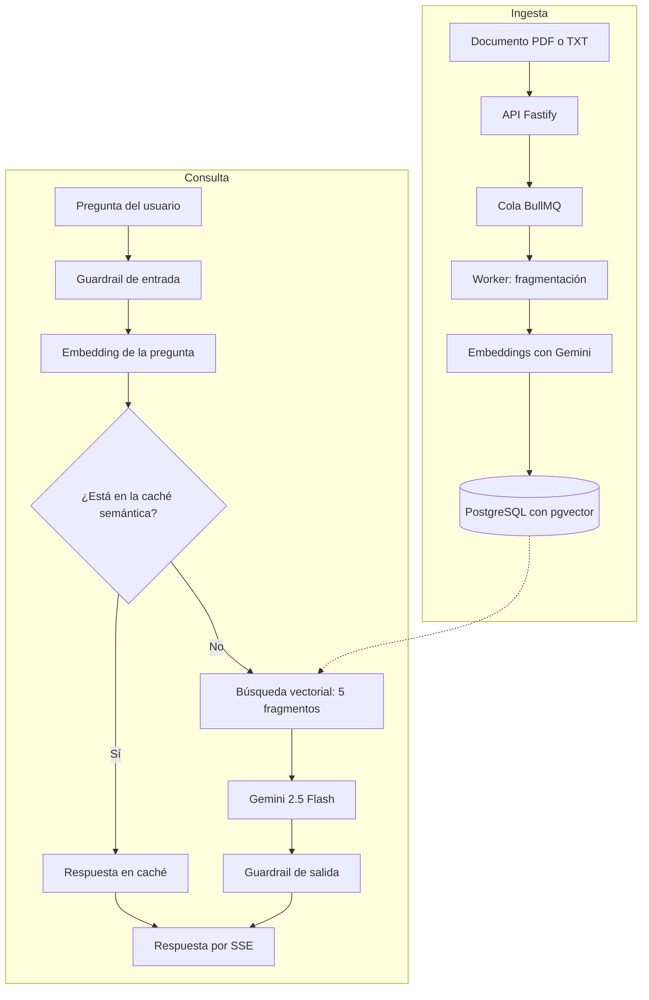

# AppAi — Plataforma RAG empresarial

Consulta los documentos internos de una empresa en lenguaje natural. AppAi indexa archivos PDF y TXT, y responde preguntas con IA generativa usando esos documentos como contexto.

> Proyecto de grado desarrollado para **Ingeniería Diseño y Servicio S.A.S (IDS)**.

## Qué hace

- **Chat sobre documentos propios:** respuestas en streaming por Server-Sent Events, con historial de conversación.
- **Indexación en segundo plano:** al subir un documento la API responde de inmediato y una cola BullMQ lo fragmenta y genera sus embeddings.
- **Caché semántica:** las preguntas similares (similitud coseno ≥ 0,92) se responden sin volver a llamar al modelo.
- **Guardrails:** validación de la entrada del usuario y de la salida del modelo.
- **Control de acceso por roles:** `ADMIN`, `GESTOR`, `INSTRUCTOR` y `EMPLEADO`.
- **Panel de administración:** consultas, tokens, latencia, tasa de aciertos de la caché y estado de la cola.
- **Seguridad de la API:** JWT con rotación de refresh tokens y límite de 30 solicitudes por minuto por usuario en el chat.

## Cómo funciona



## Stack

| Capa | Tecnologías |
|------|-------------|
| Frontend | React 19, Vite 7, TypeScript, Recharts |
| Backend | Fastify 5, TypeScript, Prisma 6, Zod |
| IA | LangChain, Gemini 2.5 Flash, `gemini-embedding-001` |
| Datos | PostgreSQL 16, pgvector con índices HNSW |
| Colas y límites | Redis 7, BullMQ |
| Infraestructura local | Docker Compose |

El backend sigue Clean Architecture, con capas `domain`, `application`, `infrastructure` e `interfaces`. El modelo de datos tiene 17 entidades.

## Puesta en marcha

Requiere Node.js 20 o superior, Docker y una API key de [Google AI Studio](https://aistudio.google.com/). Antes de iniciar, crea `backend/.env` como se indica en la [guía de instalación](docs/setup.md#variables-de-entorno).

```bash
git clone https://github.com/J4x0-o2/app-ai.git AppAi

# Terminal 1: base de datos y Redis
cd AppAi/vite-project && docker compose up -d

# Terminal 2: backend en http://localhost:3000
cd AppAi/backend && npm install && npx prisma migrate deploy && npx prisma generate && npx tsx watch src/server.ts

# Terminal 3: frontend en http://localhost:5173
cd AppAi/vite-project && npm install && npm run dev
```

## Documentación

- [Instalación y solución de problemas](docs/setup.md)
- [Arquitectura y pipeline RAG](docs/architecture.md)
- [API y permisos por rol](docs/api.md)
- Diagramas editables en draw.io: [C4](diagrams/AppAi_C4.drawio), [infraestructura](diagrams/AppAi_Infraestructura.drawio) y [secuencia UML](diagrams/AppAi_UML_Secuencia.drawio)
